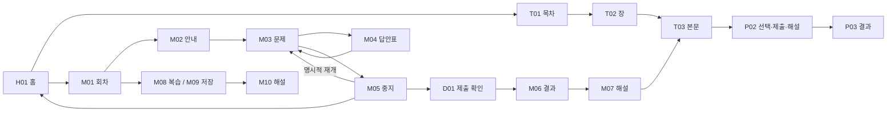

# SQLD Pass 0.3.3 Android 화면 점검

2026-11-11 · 화면 캡처와 개선 제안 · 앱 소스 및 배포 설정 변경 없음

## 판단

현재 버전은 진한 파란 카드를 반복하던 구조에서 상당 부분 정리되어 있다. 선택 필터는 연한 파란색, 주요 실행 버튼은 진한 파란색으로 구분된다. 다음 개선의 중심은 색을 일괄 연하게 만드는 일이 아니라 **문제·해설·교재에 할당하는 공간을 늘리고, 반복 설명과 보조 행동을 정리하는 것**이다.

이번에 실제로 발견한 시작 오류와 재시도 실패는 시각 정리보다 먼저 다뤄야 한다. 시험 일시정지와 명시적 재개, 답안표, 최종 제출 확인은 이미 동작하며 유지할 가치가 있다.

[화면별 PNG 갤러리](evidence/android-ui-audit-033-20261111/gallery.html) · [화면 목록 JSON](evidence/android-ui-audit-033-20261111/screen-inventory.json) · [실행 환경](evidence/android-ui-audit-033-20261111/environment.json)

## 실제 확인 환경

- Samsung SM-F721N 실기기, Android 16, 펼친 화면 1080×2640px, 480dpi, 논리 폭 360dp.
- 별도 테스트 앱 `com.sqldpass.app.adsqa` **0.3.3(19)**. 제출 후보와 같은 앱 UI 코드에 공식 테스트 광고를 사용하는 환경이다. 운영 광고 소재와 운영 패키지 자체를 캡처한 것으로 해석하면 안 된다.
- 설치된 운영 패키지 `com.kasa500000.sqldpass`는 **0.3.2(18)**. 이번 작업에서 업데이트·삭제·초기화하지 않았다.
- 기본 밝은 테마·앱 글자 100%, 대표 홈·본문은 어두운 테마·앱 글자 130%도 확인했다. 시스템 글자 배율은 1.0이다.
- 사용자 우선 진행 지시 후 기존 테스트 기록이 있는 상태를 순회하고, 별도 테스트 앱의 기록만 앱 내 전체 삭제 기능으로 지워 신규 상태를 확인했다. 운영 학습 데이터는 변경하지 않았다.
- 기존 `qa/UI_UX_20261111.md`의 이전 검증과 이번 새 캡처를 구분한다. 아래 결과는 이번 실행 범위이며 전체 출시 QA 통과 선언이 아니다.

## 우선순위와 화면별 권장안

P0는 학습 진입을 막는 문제, P1은 핵심 학습을 반복적으로 방해하는 문제, P2는 표현·정보 밀도·일관성 보완이다. 사용자 이탈·성공률 데이터는 없으며 영향과 권장안은 관찰에 근거한 설계 판단이다.

| 우선순위 / 위치 | 실제 확인한 현상 | 사용자 영향 | 권장안 | 수정 후 확인할 것 |
|---|---|---|---|---|
| **P0 / X01 시작 실패** | SQLite `NativeDatabase.execAsync` 오류가 원문 그대로 노출. ‘다시 시도’ 1회로 회복되지 않았고 강제 종료 후 실행하자 기존 기록이 보였다. | 학습에 진입하지 못하고 기록 손실로 오해할 수 있다. | 실패한 DB 연결을 안전하게 다시 생성하는 복구 경로, 쉬운 오류 문구와 별도 진단 정보. 데이터 삭제를 해결 방법으로 쓰지 않는다. | 연결 실패→재시도→기존 답안·점수·권한 보존. NPE 원인과 재현 조건 별도 조사. |
| **P1 / M03 실전 풀이** | 회차·시간·응답 수·‘문제’·‘제시 자료’·선택 안내가 문제/보기와 공간을 나눈다. 검토 표시·답 지우기는 보기 아래에 있다. | 긴 문제에서 질문과 보기 사이를 자주 스크롤하고 검토 기능을 찾기 어렵다. | 회차/현재 번호/시간/중지로 상단 압축. 응답 수는 답안표에 통합. 질문 옆 검토 표시, 답 지우기는 선택 후 보조 메뉴. 의미 없는 반복 라벨만 줄인다. | 긴 표/SQL/4줄 보기, 1번·50번, 선택 변경·검토·중지·제출의 접근성. |
| **P1 / P02 확인 문제** | 문제 풀이에도 설정·5개 탭·하단 제출 영역이 함께 보인다. 채점 후 아래에 해설이 이어지지만 버튼은 즉시 ‘다음 문제’가 된다. | 집중 공간이 좁고 왜 틀렸는지 읽기 전에 넘어가기 쉽다. | 연습도 간결한 풀이 헤더 적용. 채점 후 정오 결과와 해설 진입을 가까이 배치하고 해설 위치로 이동 가능하게 한다. 답 선택과 제출은 계속 분리한다. | 정답·오답·선택 변경·연속 탭·마지막 문항; 답안/제출 상태 보존. |
| **P1 / M07 회차 해설** | 필터·전체 폭 결과 요약·문항 선택·문제·보기·정오 결과를 거쳐야 해설이 나온다. 저장·메모·근거가 각각 큰 행이다. | 해설 확인을 위해 이동한 화면에서도 해설을 찾는 스크롤이 길다. | 결과 요약은 헤더 링크. 현재 문항+필터를 간결하게 묶고, ‘내 답/정답’ 바로 아래 해설 우선. 필요 시 원문은 명확한 펼침으로 제공. 저장/메모는 한 보조 도구 영역. | 원문 누락 없음, 선택 답·정답 구분, 관련 교재 방문 후 같은 문항·필터·위치 복귀. |
| **P1 / T03 교재** | 읽는 동안 ‘확인 문제’가 고정된 파란 주 버튼이고, 읽음 완료·하단 탭도 계속 공간을 차지한다. | 본문보다 문제 풀이 이동이 먼저 눈에 들어온다. | 읽기 중에는 중립색 보조 행동, 절 끝에서는 다음 절/확인 문제를 주 행동으로 전환. 절 위치와 저장은 간결한 헤더에 묶는다. | 읽기 위치·북마크·수동 읽음 완료 보존, 글자 130%·긴 표·SQL·다음 절·목차 복귀. |
| **P1 / M08·M09 복습/저장 목록** | 한 문항 카드에 긴 지문과 ‘다시 풀기’, ‘해설 보기’가 세로 배치. 198문항 목록의 첫 화면에 약 1.5개 카드만 보인다. | 필요한 주제나 문항을 찾아 비교하기 어렵다. | 회차·문항·주제를 우선하는 간결한 목록. 한 번 눌러 상세에서 재풀이/해설 선택. 검색·주제 필터는 같은 도구 영역으로 묶는다. | 검색·필터·스크롤 복귀, 두 기능 접근성, 재풀이가 원 시험 점수를 바꾸지 않음. |
| **P1 / D06 설정 이탈** | ‘변경 취소하고 나가기’가 파란 주 버튼이고 아래는 ‘취소’다. | 취소라는 말이 두 의미로 쓰이고 설정을 버리는 행동이 강조된다. | ‘저장하고 이동’ 주 행동, ‘저장하지 않고 이동’ 보조 행동, 닫기는 ‘계속 설정하기’. 자동 저장 전환은 별도 검토한다. | 변경 없음/있음, 저장 실패, 뒤로·탭 이동, 실제 적용값 일치. |
| P2 / H01 홈 | 이어 읽기 아래 통계 3개·설명·진행률이 큰 공간을 차지하고 학습 도구는 아래에 있다. 목차/모의고사 진입은 탭과 중복된다. | 재방문 시 다음 학습 외 정보가 많다. | 이어 읽기/중지한 시험/복습을 상태에 맞게 우선. 통계는 짧은 요약, 상세는 기록 탭. 완료 기준은 정보 안내로 옮긴다. 중복 진입은 보조 링크로 제한. | 신규·기록 있음·중지 중·배너 있음 각각에서 주 행동 명확함. |
| P2 / T01 목차·검색 | ‘교재/전체 목차’ 중복 제목, ‘저장한 절/검색어 지우기’가 각각 전체 행. 검색 미리보기도 길다. | 첫 결과까지 내려가야 하고 한 번에 비교하는 절 수가 적다. | 검색창 안 지우기, 옆 저장 필터. 결과에는 장·절·일치 부분 1~2줄. 펼침은 오른쪽 이동 화살표와 구분한다. | 검색 초기화·없음·저장 필터 조합, 읽는 중/읽음 완료 구분 유지. |
| P2 / T02 장 목차 | 장 번호·제목·소개·학습 목표 행이 목록 위에 쌓인다. | 실제 절 목록 도달이 늦다. | 소개 1~2줄과 접힌 목표. 장 내 진도와 첫/이전 학습 행동을 짧게 제공. | 긴 장 제목, 목표 펼침, 기존 절 ID/순서 유지. |
| P2 / D04 표·SQL | 표 캡션에 행 수가 중복되고, 표 확대는 이 샘플에서 글자/열 폭이 크게 달라지지 않는다. | ‘크게 보기’의 기대와 결과가 다르다. | 캡션의 생성형 메타 중복 제거. 실제 확대/가로 보기 또는 ‘전체 표 보기’로 명확한 이름. SQL의 중립 배경과 줄바꿈 기능은 유지. | 긴 열, 가로 스크롤, 확대 닫기, 원문 수치/열 순서 불변. |
| P2 / P01 연습 선택 | ‘10문항 · 10문항 풀기’ 등 같은 문항 수 반복, 풀이할 복습이 0이어도 큰 비활성 행. | 선택 화면이 길고 정보 차이가 약하다. | 장/문항 수를 한 번 표시. 빈 복습은 짧은 상태 안내와 첫 연습 진입. | 5/10/20/전체 선택과 실제 세션 문항 수 일치. |
| P2 / P03 연습 결과 | 점수 뒤 관련 교재가 별도 그룹 제목 없이 이어진다. | 결과와 다음 공부할 내용을 구분하기 어렵다. | 정답/오답 요약과 ‘틀린 문제 다시 풀기’를 우선, 아래 ‘관련 교재’ 제목으로 묶는다. | 2/5 등 실제 집계 일치, 복습 이후 최초 결과 보존. |
| P2 / M01·M02 열린 회차/안내 | 목록은 현재 간결해졌고 모드 선택과 시작 버튼 색상도 구분된다. 안내에는 길게 나열된 정책 문단이 남는다. | 첫 시작 전 읽어야 할 양이 많다. | 목록 구조/모드 구분 유지. 시간·일시정지·최종 제출 후 해설을 짧게 묶고 상세 기준은 접기. 잠긴 회차의 보상 조건은 버튼 가까이 유지. | 무료/잠김/해제/제출 완료/중지 상태별 안내와 권한 정확성. |
| **P1 / M01 잠긴 회차 목록** | 잠긴 회차마다 긴 안내·연령 문구·파란 광고 버튼·상세 안내가 반복된다. 한 화면에 약 2개 카드뿐이며 무료/열린 회차의 간결한 행과 차이가 크다. | 모의고사를 고르는 화면이 광고 신청 목록처럼 보이고 뒤 회차 탐색이 길어진다. | 회차·잠금 상태를 간결한 행으로 통일하고 선택한 회차에 필수 고지/광고 행동을 모은다. 안내를 접는 설계는 광고 시작 탭 수와 기존 원탭 접근의 균형을 별도 확인해야 한다. | 명시적 시청 의사·연령/동의·보상 조건 보존, 광고 취소 시 잠금 유지. 테스트 광고 전용 문구를 운영 노출량으로 계산하지 않음. |
| P2 / M04 답안표 | 통계·필터·범례·안내가 반복되고 미응답 번호는 평문에 가까워 보인다. | 상태 해석과 누를 곳 파악에 부담이 있다. | 필터에 개수 통합, 짧은 범례. 약한 테두리로 타일 터치 영역 명확화. 5열·충분한 터치 크기는 유지. | 답한/미응답/검토 겹침, 숫자 선택, 큰 글자, 제출 취소. |
| P2 / M06 결과 | 점수·판정·날짜·중지·정오·과목 결과가 여러 세로 블록이다. | 점수와 다음 복습 행동이 멀어진다. | 점수와 정오를 한 요약, 날짜/중지 이력은 한 보조 행. 과목별 상세는 아래. 중지 정보는 삭제하지 않는다. | 정답+오답+미응답=50, 점수 불변, 과거 중지 정보 없음≠0회. |
| P2 / M10 저장 해설 | 동일한 문항이 회차 해설과 달리 보기 평문/정답 텍스트 중심으로 표시된다. | 진입 경로에 따라 읽는 방법이 달라진다. | 문제·보기·정답·해설 공통 컴포넌트 사용. 특정 응시 연결이 없는 저장 문항에는 임의의 ‘내 답’을 붙이지 않는다. | 원문/정답 동일, 저장 상태·복습 맥락 보존. |
| P2 / M11 응시 기록 | 실전/학습 통계 카드에 같은 집계 설명이 반복되어 최근 기록이 아래로 밀린다. | 최근 응시를 바로 열기 어렵다. | 두 모드 통계는 작은 비교 영역, 집계 설명 한 번. 최근 기록을 앞쪽으로. | 실전/학습 집계 분리, 회차별 최근 점수와 전체 응시 기록 구분. |
| P2 / R01 학습 기록 | 지표 설명과 Part별 진도가 넓은 세로 영역을 사용한다. | 전체 학습 진도를 한눈에 비교하기 어렵다. | 진도·풀이 수·정답률 정의는 정보 안내. Part 진도는 간결한 행, 최근 결과 연결 유지. | 진도와 정답률 혼동 없음, 새 사용자 0 상태의 시작 행동. |
| P2 / T04 용어 사전 | 검색 지우기가 별도 큰 행. 펼친 용어에서는 짧은 정의와 전체 정의가 반복되는 구조다. | 검색 결과와 실제 정의를 읽는 공간이 줄어든다. | 입력창 내 지우기. 펼치면 요약 대신 전체 정의를 보여 중복 제거. 펼침/이동 아이콘 구분. | NULL 검색·검색 없음·관련 절 이동 후 검색어 복귀. |
| P2 / T05 핵심 카드 | 답을 연 뒤 ‘답 접기’가 답보다 위의 전체 행, 관련 개념·알고 있음도 큰 세로 행이다. | 회상 후 답과 자기 평가의 연결이 약하다. | 질문/답을 중심에 놓고 접기는 작은 보조 조작. ‘알고 있음’과 ‘다음 카드’를 가까이 배치. | 알려진 카드 필터, 표시 해제·앞뒤 이동, 기존 카드 상태 보존. |
| P2 / S01 설정 | 바꾼 것이 없어도 파란 저장 버튼이 항상 활성. 목표일 없음 상태에도 ‘목표일 없이 학습’ 행이 있다. | 불필요한 행동이 필요해 보인다. | 변경할 때만 저장 활성. 목표일이 있을 때만 제거 행동 표시. | 저장 전/후 값과 안내 일치, 미저장 보호 유지. |
| P2 / 공통 펼침 | 목차/FAQ/용어의 펼침에도 오른쪽 이동 화살표가 사용된다. | 새 화면 이동인지 같은 자리 펼침인지 예측하기 어렵다. | 펼침은 아래/위, 이동은 오른쪽 화살표. | 확장 상태 접근성 전달, 모든 화면 일관성. |

## 유지할 부분

- **M05 일시정지:** 남은 시간·저장 상태, 한 개의 명확한 ‘이어서 풀기’, 보조 홈/제출. 홈의 이어하기가 중지 화면을 먼저 여는 것은 명시적 재개 정책과 연결되므로 자동 재개로 바꾸지 않는다. 첫 버튼을 ‘중지한 시험 보기’로 명확히 할 수 있다.
- **D01 최종 제출:** 미응답 수와 제출 후 변경 불가 안내, 취소 경로. 미응답이 있어도 제출 가능한 기존 규칙을 유지한다.
- **정오 표현:** 초록/빨강에 정답·오답 문구를 함께 제공. 색을 일괄 회색으로 바꾸지 않는다.
- **S02 알림, S03 데이터, S04 개인정보, S05 도움말:** 현 기능 범위와 삭제/동의 보호를 유지. 보조 설명 간격과 펼침 표현 정도를 정리한다. 광고·연령·개인정보 안내는 장식 버튼으로 간주해 삭제하지 않는다.
- **A01 첫 실행:** 시작 행동 1개와 범위/로컬 저장 안내 유지. A02의 선택 설정은 기본값으로 바로 진행할 수 있음을 더 짧게 전달할 수 있다.
- **D03 삭제 확인:** 범위와 취소 보호 유지. 전체 삭제 확인 제목은 ‘기기의 학습 기록을 초기화할까요?’보다 ‘전체 데이터를 삭제할까요?’로 구분하는 편이 명확하다.
- **T06/M12 출처:** 실제 콘텐츠 근거와 범위 안내 유지. 외부 링크 전체 도착점은 이번에 재검증하지 않았다.

## 공통 시각 규칙 제안

현재 `src/ui/nodes.ts`의 본문 17/28, 질문 18/29·600, 보기 16/26·400, 보조 13/20을 기본으로 유지한다. 본문을 작게 만들거나 대비를 줄여 공간을 확보하지 않는다. 상단 메타·반복 행·불필요한 카드 안 여백을 먼저 줄인다.

- 진한 파랑: 현재 과업을 실행하는 주 행동 1개. 계속 읽는 화면에서는 즉시 다른 과업으로 보내는 버튼의 강조를 낮춘다.
- 연한 파랑/테두리: 선택·필터. 현재 구현은 이미 이 구분을 사용한다.
- 중립색: 이전/다음 탐색, 저장·메모·상세 기준 등 보조 행동. 터치 크기는 유지한다.
- 초록·빨강: 학습 결과와 삭제 위험. 텍스트/아이콘 병행.
- 흰 본문과 약한 구분선: 콘텐츠 묶음. 같은 정보에 카드·굵은 제목·전체 폭 버튼을 모두 반복하지 않는다.

[Android 버튼 가이드](https://developer.android.com/develop/ui/compose/quick-guides/content/create-button)의 행동 위계와 [Android 접근성 가이드](https://developer.android.com/guide/topics/ui/accessibility/apps)의 48dp 목표 및 작은 글자 4.5:1 대비를 기준으로 한다. 네이티브 Android dp와 스크린샷 px를 구분한다. 이번 캡처로 전체 접근성 적합성을 인증한 것은 아니다.

## 현재 흐름과 권장 흐름

권장 변경은 이 경로와 데이터 구조를 유지하면서 화면 내부 순서를 바꾸는 것이다.

| 과업 | 현재 화면 내부 순서 | 권장 순서 |
|---|---|---|
| 교재 읽기 | 위치·제목·본문 + 항상 파란 확인 문제 | 간결한 위치·본문 우선 → 절 끝에서 다음 학습 |
| 문제 풀이 | 여러 상태/라벨 → 문제 → 자료 → 보기 → 검토 | 번호·시간·중지 → 질문+검토 → 자료·보기 → 제출/다음 |
| 해설 확인 | 필터·결과 버튼·문항 선택 → 문제·보기 → 정오 → 해설 | 간결한 탐색 → 내 답/정답·해설 → 필요한 원문 펼침 |
| 저장 문항 찾기 | 큰 지문 카드 → 재풀이/해설 2행 | 주제·회차·번호 목록 → 상세에서 행동 선택 |
| 설정 이동 | 버리기 강조 / 취소 | 저장하고 이동 / 저장하지 않고 이동 / 계속 설정 |

## 실행 기록과 한계

시각 관찰과 실제 조작을 구분한다. 화면 캡처만으로 저장·점수 정확성을 통과 처리하지 않았다.

| 시작 상태 | 실제 조작 | 실제 결과 / 증거 | 미확인 |
|---|---|---|---|
| 기존 테스트 기록 있음, 시작 오류 | 다시 시도 1회 → 강제 종료/재실행 | 재시도 실패, 재실행 후 기록 표시. `X01-*` | NPE 최초 원인·빈도, 모든 DB 실패 형태 |
| 기존 교재 읽기 | 장/절 이동, 표 전체 보기, SQL/아래 읽기 | 본문·표·코드·저장 위치 화면 확인. `T02-*`, `T03-*`, `D04-table-*` | 216절/37개 도구의 모든 상태 |
| 연습 5문항 | 선택·채점·해설·다음·마지막 제출 | 2/5 정답 결과. `P02-*`, `P03-result` | 모든 340문항, 연속 탭 스트레스 |
| 실전 02회 | 1번 답 선택, 답안표에서 50번 이동·검토, 중지→홈→복귀 | 남은 시간 01:29:04 유지, 명시적 재개 화면, 답변 유지. `M03-*`, `M04-*`, `M05-*` | 90분 실제 만료, OS 강제 사망 전체 분기 |
| 중지한 02회 | 제출 확인 취소 후 다시 최종 제출 | 2점·정답1·오답0·미응답49, 중지1회. `D01-submit-confirm`, `M06-result` | 전체 점수 조합 재검증 아님 |
| 제출한 02회 | 해설·문항 선택·메모·저장·복습/기록 | `UI audit note` 저장 안내, 저장 목록1개, 응시 기록에서 결과 확인. `M07-*`~`M11-*` | 실제 한글 장문 메모/IME 가림 전체 검증 |
| 설정 화면 | 글자 변경 후 탭 이동→취소, 어둡게/130% 저장, 밝게/100% 복원 | 이탈 확인·테마/큰 글자 적용. `D06-*`, `H01-dark-large`, `T03-dark-large` | 시스템 최대 글자·TalkBack·접힘/가로 |
| 사전·카드 | NULL/없는 검색어, 초기화, 카드 답 확인·알고 있음·필터 | 검색 결과/없음, 카드 상태 변경. `T04-*`, `T05-*`, `X02-*` | 모든 용어/카드 |
| 설정·데이터·도움말 | 날짜·알림·개인정보·FAQ·삭제 확인 열기/취소 | 정상 화면 및 취소 경로. `S01-*`~`S05-*`, `D03-*`, `D04-date-*` | 실제 알림 도착·외부 링크 장애 |

신규 상태 추가 실행: 테스트 앱 전체 삭제 후 첫 실행→기본 학습 설정→홈→빈 기록/복습/저장 목록을 캡처했다(`A01`, `A02`, `H01-first-use`, `R01-empty`, `M08-empty`, `M09-empty`, `M11-empty`). 이후 19회에서 공식 테스트 광고를 직접 시작했고 SDK의 ‘리워드 지급됨’ 표시 후 닫아 회차 시작 버튼이 나타나는 것을 확인했다(`D05-reward-test/completed`, `M02-test-unlocked`). 학습 모드 시작→중지→미응답 50개 최종 제출은 0점·중지1회로 표시됐다(`M03-study`, `M05-study-paused`, `M06-study-result`). 이 과정은 테스트 앱의 기록만 생성했다. 광고 조기 닫기/모든 지역 UMP/운영 광고 검증으로 확대 해석하지 않는다.

자동화 중 열린 키보드 위에 탭을 보내거나 스크롤 목표를 지나친 경우는 조작 하네스 실패로 분류하고 화면을 다시 확인했다. 앱 결함이나 성공으로 집계하지 않았다. 사전 검색에서는 실제 키보드가 열린 모습을 캡처했지만 메모 입력 캡처는 키보드가 없는 상태이므로 한글 IME 검증 근거로 사용하지 않는다.

시작 재시도 관련 코드 근거: `src/platform/native.ts`의 생성자는 하나의 읽기 전용 DB Promise를 만들고 `load()`가 계속 기다린다. `src/core/controller.ts`의 `initialize()` 재호출은 repository를 다시 만들지 않는다. **DB 열기 Promise가 거절된 경우 재시도에서도 같은 거절을 재사용하는 구조는 확인했다.** 이번 native NPE가 왜 최초 발생했는지까지 확정한 것은 아니다. 강제 재실행 후 기록이 보였으므로 데이터 손실을 확인했다고 보고하지 않는다.

이번 작업은 앱 소스 변경이 없는 관찰이므로 빌드·단위 테스트를 새로 실행하지 않았다. PNG/XML과 목록/링크 무결성을 검사했다. 이전 자동 검사·다른 기기 실행 결과를 이번 새 실기기 검사로 세지 않는다.

추가 미확인: EEA 등 모든 지역 UMP 허용/거부/철회, 운영 광고, 디스크 가득 참/저장 실패 주입, 모든 외부 링크, 구교재 전환 및 출시 게이트, iOS, 태블릿/가로/접힘 전환, TalkBack. 로그인/계정/독립 계산기는 현 앱에 없다.

## 다음 구현 순서

1. 시작 실패 재시도 복구와 원인 조사.
2. 실전·연습 풀이/해설의 공간 배분, 검토 위치, 설정 이탈 행동 정리.
3. 홈·목차·복습 목록·결과·기록의 정보 밀도 조정.
4. 사전·카드·표·설정의 작은 반복 제거 후 같은 문항·크기로 전후 비교.

콘텐츠/문항 ID, 원문, 채점 규칙, SQLite 순차 저장, 중지 시간 정책, 이용 권한·동의·earned reward 조건은 변경 범위에서 분리해 보호한다. 이번에는 구현·커밋·스토어 제출을 수행하지 않았다.

## 전체 화면 처리 목록

이번에는 코드 개선이 아니라 검토 결과를 표시한다. 모든 일반 진입 화면 유형을 순회했고 조건부 오류·마이그레이션 상태는 아래와 같이 구분한다.

| ID | 화면 | 이번 확인 | 권장 처리 | 대표 캡처 |
|---|---|---|---|---|
| A01 | 첫 실행 | 대표 상태 캡처 확인 | 학습 시작 1개 행동과 로컬 저장 안내 유지. | [A01-welcome](evidence/android-ui-audit-033-20261111/A01-welcome.png) |
| A02 | 학습 설정 | 대표 상태 캡처 확인 | 기본값으로 바로 시작 가능. 선택 설정의 반복 설명 축소. | [A02-setup](evidence/android-ui-audit-033-20261111/A02-setup.png) |
| H01 | 홈 | 대표 상태 캡처 확인 | 이어 학습 우선, 통계·반복 진입 압축. | [H01-dark-large](evidence/android-ui-audit-033-20261111/H01-dark-large.png) |
| T01 | 목차·검색·저장 필터 | 대표 상태 캡처 확인 | 검색창 내 지우기·저장 필터 통합. | [T01-bookmarks](evidence/android-ui-audit-033-20261111/T01-bookmarks.png) |
| T02 | 장별 목차 | 대표 상태 캡처 확인 | 장 소개·학습 목표를 간결하게. | [T02-chapter-goals](evidence/android-ui-audit-033-20261111/T02-chapter-goals.png) |
| T03 | 교재 본문 | 일부 상태 확인 | 본문 우선, 읽는 중 확인 문제 강조 완화. | [T03-dark-large](evidence/android-ui-audit-033-20261111/T03-dark-large.png) |
| T04 | 용어 사전 | 대표 상태 캡처 확인 | 검색 도구·정의 중복 정리. | [T04-expanded](evidence/android-ui-audit-033-20261111/T04-expanded.png) |
| T05 | 핵심 카드 | 대표 상태 캡처 확인 | 답과 알고 있음·다음 카드 연결 개선. | [T05-answer](evidence/android-ui-audit-033-20261111/T05-answer.png) |
| T06 | 출처·범위 | 대표 상태 캡처 확인 | 출처 유지; 외부 링크 전체 미검증. | [T06-sources](evidence/android-ui-audit-033-20261111/T06-sources.png) |
| P01 | 연습·복습 선택 | 대표 상태 캡처 확인 | 문항 수 중복과 빈 복습 행 정리. | [P01-practice-hub](evidence/android-ui-audit-033-20261111/P01-practice-hub.png) |
| P02 | 문제풀이·해설 | 대표 상태 캡처 확인 | 풀이 집중과 채점 후 해설 접근 우선. | [P02-explanation](evidence/android-ui-audit-033-20261111/P02-explanation.png) |
| P03 | 연습 결과 | 대표 상태 캡처 확인 | 정오 요약·관련 교재 그룹 구분. | [P03-result](evidence/android-ui-audit-033-20261111/P03-result.png) |
| M01 | 모의고사 목록 | 대표 상태 캡처 확인 | 현재 목록/필터는 유지, 반복 광고 안내 간결화. | [M01-completed-filter](evidence/android-ui-audit-033-20261111/M01-completed-filter.png) |
| M02 | 응시·광고 안내 | 대표 상태 캡처 확인 | 시간·중지·해설 조건을 짧게. | [M02-intro-study](evidence/android-ui-audit-033-20261111/M02-intro-study.png) |
| M03 | 실전/학습 풀이 | 대표 상태 캡처 확인 | 문제·보기 공간 확대, 검토를 질문 가까이에. | [M03-bottom-actions](evidence/android-ui-audit-033-20261111/M03-bottom-actions.png) |
| M04 | 답안표 | 대표 상태 캡처 확인 | 통계·범례 간결화, 타일 경계 명확화. | [M04-answer-sheet](evidence/android-ui-audit-033-20261111/M04-answer-sheet.png) |
| M05 | 일시정지·저장 실패 | 일부 상태 확인 | 명시적 재개·저장 안내 유지. | [M05-paused](evidence/android-ui-audit-033-20261111/M05-paused.png) |
| M06 | 모의고사 결과 | 대표 상태 캡처 확인 | 점수와 정오를 묶고 중지 정보는 보존. | [M06-result](evidence/android-ui-audit-033-20261111/M06-result.png) |
| M07 | 회차별 해설 | 대표 상태 캡처 확인 | 해설을 앞에, 결과/저장/메모 조작 간결화. | [M07-evidence](evidence/android-ui-audit-033-20261111/M07-evidence.png) |
| M08 | 오답·미응답 복습 | 대표 상태 캡처 확인 | 주제·회차 중심의 작은 목록. | [M08-empty](evidence/android-ui-audit-033-20261111/M08-empty.png) |
| M09 | 저장 문항 | 대표 상태 캡처 확인 | 목록 1개 진입 후 상세 행동. | [M09-empty](evidence/android-ui-audit-033-20261111/M09-empty.png) |
| M10 | 저장/복습 해설 | 대표 상태 캡처 확인 | 회차 해설과 공통 표현. | [M10-saved-explanation](evidence/android-ui-audit-033-20261111/M10-saved-explanation.png) |
| M11 | 모의고사 기록 | 대표 상태 캡처 확인 | 중복 집계 설명 압축, 최근 기록 우선. | [M11-empty](evidence/android-ui-audit-033-20261111/M11-empty.png) |
| M12 | 모의고사 출처 | 대표 상태 캡처 확인 | 출처/범위 안내 유지. | [M12-sources](evidence/android-ui-audit-033-20261111/M12-sources.png) |
| R01 | 학습 기록 | 대표 상태 캡처 확인 | Part 진도 행 압축, 지표 정의는 정보 안내. | [R01-empty](evidence/android-ui-audit-033-20261111/R01-empty.png) |
| S01 | 설정 | 대표 상태 캡처 확인 | 변경 시 저장 활성, 불필요한 목표일 제거 행동 숨김. | [S01-settings-lower](evidence/android-ui-audit-033-20261111/S01-settings-lower.png) |
| S02 | 학습 알림 | 대표 상태 캡처 확인 | 알림 기능 유지; 실제 도착은 미확인. | [S02-reminders](evidence/android-ui-audit-033-20261111/S02-reminders.png) |
| S03 | 데이터 관리 | 대표 상태 캡처 확인 | 삭제 범위 구분 유지. | [S03-data](evidence/android-ui-audit-033-20261111/S03-data.png) |
| S04 | 개인정보 | 대표 상태 캡처 확인 | 정책·동의 진입 유지. | [S04-privacy](evidence/android-ui-audit-033-20261111/S04-privacy.png) |
| S05 | 도움말 | 대표 상태 캡처 확인 | FAQ 유지, 펼침 아이콘 개선. | [S05-help-expanded](evidence/android-ui-audit-033-20261111/S05-help-expanded.png) |
| D01 | 최종 제출 확인 | 대표 상태 캡처 확인 | 미응답·제출 후 변경 불가·취소 유지. | [D01-submit-confirm](evidence/android-ui-audit-033-20261111/D01-submit-confirm.png) |
| D02 | 해설 문항 선택 | 대표 상태 캡처 확인 | 문항 선택 유지. 닫기 중복은 코드상 추가 보완 후보. | [D02-question-picker](evidence/android-ui-audit-033-20261111/D02-question-picker.png) |
| D03 | 초기화·전체 삭제 확인 | 대표 상태 캡처 확인 | 전체 삭제 제목을 학습 기록 초기화와 명확히 구분. | [D03-delete-confirm](evidence/android-ui-audit-033-20261111/D03-delete-confirm.png) |
| D04 | 표 확대·SQL 줄바꿈·날짜 | 대표 상태 캡처 확인 | 표 확대 의미·캡션 중복 개선. 날짜 기본 동작 유지. | [D04-date-picker](evidence/android-ui-audit-033-20261111/D04-date-picker.png) |
| D05 | 광고 연령·UMP·보상 SDK | 일부 상태 확인 | 동의·보상 조건은 시각 단순화와 별개로 유지. | [D05-privacy-choice](evidence/android-ui-audit-033-20261111/D05-privacy-choice.png) |
| D06 | 미저장 설정 확인 | 대표 상태 캡처 확인 | 저장하고 이동 우선, 취소의 두 의미 제거. | [D06-unsaved-settings](evidence/android-ui-audit-033-20261111/D06-unsaved-settings.png) |
| X01 | 시작 로딩·실패·재시도 | 일부 상태 확인 | P0: 연결 재생성 재시도와 원인 조사. | [X01-restart-recovered](evidence/android-ui-audit-033-20261111/X01-restart-recovered.png) |
| X02 | 빈 상태·검색 없음 | 대표 상태 캡처 확인 | 빈 상태 안내와 학습 시작/조건 초기화 제공. | [X02-exams-empty](evidence/android-ui-audit-033-20261111/X02-exams-empty.png) |
| X03 | 저장·외부·광고 실패 | 미확인 | 미확인; 정상 캡처로 오류 복구 통과를 주장하지 않음. | 없음 |
| X04 | 교재 전환·출시 게이트 | 미확인 | 현 버전 비대상; 강제 데이터 전환 없음. | 없음 |

새 원본 PNG **100장**, PNG별 UI XML 동반. **40개 화면·상태 그룹 중 38개에 대표 캡처**를 연결했다. 미확인 조건을 전체 통과로 표시하지 않는다.
