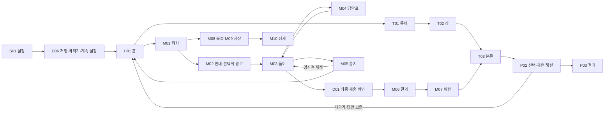

# SQLD Pass 0.3.4 학습 집중 UI 개선·검증

2026-11-11. 소유자가 화면별 권장 개선, 작업별 PR·커밋과 양 스토어 출시를 위임했다. Android 0.3.4(20), iOS 0.3.4(14) 후보. 기존 0.3.3은 양 스토어 공개 출시를 확인했다. Android0.3.4(20)는 프로덕션 심사 제출 완료·승인 후100% 자동 출시다. iOS0.3.4는 출시 초안만 준비했으며 새 TestFlight/정식 제출은 아직 하지 않았다. [서버 실행 상태](../release/STORE_STATUS_20261111.json)를 따른다.

[전체 캡처 갤러리](evidence/ui-focus-034-20261111/gallery.html) · [40개 화면·상태 목록](evidence/ui-focus-034-20261111/screen-inventory.json) · [개선 전 Android 점검](ANDROID_UI_AUDIT_033_20261111.md) · [설계 기준](../docs/UI_FOCUS_034_20261111.md)

## 주요 결과

- 풀이 화면의 반복 설명·응답 통계를 정리하고 질문, 검토 표시, 보기와 다음 행동을 우선했다. 일반 연습도 풀이 중 탭을 숨기며 나가기 후 선택한 답부터 이어간다.
- 해설은 내 답·정답 비교와 설명이 먼저 나온다. 문제·표·SQL·원 보기는 ‘문제와 제출한 답안’을 펼쳐 그대로 확인한다. 저장·복습 목록은 주제와 문항을 먼저 찾는 간결한 행으로 바꿨다.
- 교재의 고정 확인 문제 버튼은 중립적으로 표시하고 절 끝에서 주 행동으로 제공한다. 표 확대는 실제 글자·열 폭을 확대하며, 표 영역만 가로로 이동한다.
- 홈은 이어 학습, 목차는 절 탐색, 결과는 정오 집계, 기록은 최근 응시에 집중한다. 검색 지우기는 입력창 안으로 옮겼고, 사전·핵심 카드의 반복 문구를 줄였다.
- 설정 이탈 시 ‘저장하고 이동 / 저장하지 않고 이동 / 계속 설정’을 구분한다. 변경이 없으면 저장 버튼은 비활성이다. 목표일 제거 버튼 중복도 없앴다.
- 잠긴 모의고사는 목록에서 회차를 선택한 후 해당 회차 안내에서 광고를 직접 시작한다. 성인 이용 안내·UMP·earned-event-only 지급·영구 로컬 해제 조건은 보존한다.
- SQLite 연결 실패 시 연결을 새로 열어 재시도한다. 데이터 초기화는 하지 않는다. 최초 native NPE의 발생 원인까지 규명했다고 주장하지 않는다.
- 추가 실기기 검사에서 Android 최종 제출 확인창이 Activity blur를 유발해 즉시 일시정지로 바뀌는 결함을 발견했다. 앱 소유 확인창을 같은 Activity 안에서 표시하도록 수정했다. 실제 알림창·백그라운드 중단은 계속 시간을 멈춘다.

## PR별 변경

| PR | 작업 | 커밋 |
|---|---|---|
| [51](https://github.com/kasa500000-png/SQLD-Pass/pull/51) | 실패한 SQLite 연결 재생성·기록 보존 | 310b0ac |
| [52](https://github.com/kasa500000-png/SQLD-Pass/pull/52) | 실전·연습 풀이 집중 화면 | cd423f8 |
| [53](https://github.com/kasa500000-png/SQLD-Pass/pull/53) | 해설·복습·저장 문항 | 9b49285 |
| [54](https://github.com/kasa500000-png/SQLD-Pass/pull/54) | 교재·표·절 이동 | afdec17 |
| [55](https://github.com/kasa500000-png/SQLD-Pass/pull/55) | 홈·탐색·사전·핵심 카드 | de55585 |
| [56](https://github.com/kasa500000-png/SQLD-Pass/pull/56) | 결과·기록 정보 정리 | f4567e1 |
| [57](https://github.com/kasa500000-png/SQLD-Pass/pull/57) | 설정 저장·이탈 보호 | 1732e9b |
| [58](https://github.com/kasa500000-png/SQLD-Pass/pull/58) | 회차 선택·광고 시작 분리 | 8532eb1 |
| [59](https://github.com/kasa500000-png/SQLD-Pass/pull/59) | Android 확인창·표 확대의 잘못된 중단 방지 | dde3fde |

위 9개 PR은 각각 관련 회귀·타입 검사 및 GitHub CI 통과 후 main에 병합했다. [통합 PR60](https://github.com/kasa500000-png/SQLD-Pass/pull/60)은 버전 번호, 마지막 날짜 버튼 정리와 검증 증거를 묶었으며 CI#153 통과 후 병합했다.

## 화면 처리와 영향

전체 목록의 ID·진입·목적·주요 행동·연결·컴포넌트·근거·한계는 JSON에 남겼다. 홈, 교재/검색/장/본문, 사전·카드, 문제 선택/풀이/결과, 모의고사 목록/안내/풀이/답안표/해설/복습/저장/기록, 통계, 설정 및 주요 확인창을 개선했다. 첫 실행·일시정지 정책·알림·삭제·개인정보·도움말·출처는 핵심 동작을 유지했다.

표·SQL·위젯은 대표 내용만 확인했다. 216절·37개 도구·모든 문제의 모든 표시 상태, 실제 저장장치 고장·전체 지역 동의·TalkBack/VoiceOver는 미확인으로 남긴다. 로그인·계정·독립 계산기는 이 앱에 없다.

| 과업 | 개선 전 | 개선 후 |
|---|---|---|
| 문제 풀기 | 반복 상태·라벨 → 문제·자료·보기 → 검토 | 번호·시간·중지 → 질문 옆 검토 → 자료·보기 → 다음/제출 |
| 연습 해설 | 원문·보기 아래 해설, 탭 노출 | 제출 후 정오·설명부터, 원문/근거 유지, 풀이 집중 |
| 회차 해설 | 필터·전체 폭 요약·원문·보기 후 설명 | 내 답·정답·설명 → 필요 시 원문 펼침 |
| 잠긴 회차 | 회차마다 광고 안내·파란 실행 반복 | 간결한 회차 선택 → 해당 회차 안내 → 명시적 광고 시작 |
| 설정 이동 | 버리기 강조·모호한 취소 | 저장하고 이동 / 저장하지 않고 이동 / 계속 설정 |

기존 5개 탭과 경로, 90분 활성 풀이 시간, paused의 active gate, 점수·답안·학습 ID와 저장 구조는 유지한다. 새 콘텐츠나 추가 모의고사는 없다. 콘텐츠 해시 `1f7a60245d9b75a19ad733dca7fc281539d73ebdc0fcfa25fd5a959ebd7d589d` 유지.

## 실제 검증

Android는 Samsung SM-F721N, Android16, 1080×2640px/360dp, 공식 테스트 광고 별도 패키지 `com.sqldpass.app.adsqa`. 운영 앱 `com.kasa500000.sqldpass`의 데이터는 변경하지 않았다. iOS는 iPhone17 402pt, SE3 375pt, iPad1032pt/가로 시뮬레이터이며 실제 iPad 증거로 해석하지 않는다.

| 시작 상태·조작 | 기대 결과 | 실제 결과·증거 | 한계 |
|---|---|---|---|
| Android0.3.3의 답2개·검토1개·2번 위치·중지01:29:50 → 0.3.4 덮어설치 | 상태·시간·기록 유지 | 01~05 PNG/XML: 그대로 복원 | 동일 QA 패키지 업그레이드; 운영 설치 데이터 직접 복사 안 함 |
| 풀이 중 답안표→제출 확인 | 확인창 유지·취소 가능 | 초기 `07`에서 결함 발견. PR59 후 `07b`, `08`: 취소·재제출·결과 이동 정상 | `07`은 통과 근거가 아님 |
| 정답1·오답1·미응답48 제출→해설→저장→재풀이 | 점수2·집계50·해설 연결·기존 시험 불변 | 08~16: 결과·해설·저장·1문제 재풀이, 과거19회 기록과 점수 유지 | 전체 점수 조합은 단위 검사 |
| 연습 선택 후 나가기→홈→이어하기→제출 | 선택 상태 복원·한 번 채점 | 13~15 및 iOS learning journey 통과 | 모든 빠른 연속 탭 실기기 스트레스 아님 |
| 모의고사13번 넓은 표→확대→Android뒤로 | 표 확대만 닫히고 풀이 유지 | 25~27: 타이머 계속, 같은13번 | TalkBack 초점은 미검증 |
| 알림창 열기→닫기→홈 | 자동 중지·시간 동결·홈 광고 없음 | 28~29: 01:29:38 일시정지 | 90분 실제 대기 대신 시간 경계 단위 검사 |
| 설정 변경→탭 이동·계속/버리기/저장 | 값·목적지 일치 | 18~20, iOS 캡처; 저장 실패/잘못된 날짜는 회귀 검사 | 실기기 디스크 가득 참 미주입 |
| 교재 검색 없음→지우기→장→본문 | 초기화·이전 읽기 위치 복원 | 21~24 및 iOS auxiliary 통과 | 모든 검색어 조합 미검증 |
| 광고 연령 확인 취소→확인 | 취소 시 SDK 배너 없음, 확인 후 테스트 배너 | 30~32 | 한국 현재 상태; EEA 신규 반복 아님 |
| M05 광고 끝까지→닫기 | earned 후 선택 회차만 열림 | 33~36: ‘테스트 광고’, ‘리워드 지급됨’, 시작 버튼 | 운영 광고 노출/클릭 사용 안 함 |
| 새 테스트 APK 업데이트·M09 광고 직후 강제 종료 | 기존 해제 유지·미지급 회차 잠금 유지 | 45~46: M05 열림 유지·M09 잠금 | 닫기 버튼 취소와 구분, earned 후 프로세스 사망 복구는 보장하지 않음 |
| 목표일 선택→제거 | 제거 버튼 한 개·빈 값 복원 | Android47~48, iOS final date 13.040초 통과 | 실제 native 날짜 선택 수행 |
| Android 카드·사전·오답·설정 보조 화면 | 변경된 조작·보호 유지 | 53~61: 카드 표시/필터·NULL 검색/지우기·오답 목록·알림·삭제 취소·개인정보·FAQ | 알림 발송·전체 삭제는 실행하지 않음 |
| iPhone402/375pt 학습 여정 | 읽기·선택·50번·중지·재실행·제출·해설·복습 | XCTest learning 2건 통과, PNG/트리 | 시뮬레이터 |
| iPhone375pt 보조 화면 | 카드·사전·검색·알림·삭제 확인 취소 | XCTest auxiliary 통과 | 실제 알림 수신 미검증 |
| SE3 시스템 최대 글자 | 스크롤하여 선택·중지·최종 제출 가능 | XCTest large text 53.262초 통과 | 첫 화면 밀도는 낮아짐. 사용자 성공률 측정 아님 |
| iPad 가로 | 본문·문제·중지·제출 접근 | XCTest landscape17.460초 통과 | 시뮬레이터; 폴더블 접힘 미검증 |

자동 검사: `npm test` **436/436**, `npm run typecheck:native` 통과(core 타입 검사는 npm test에 포함). 콘텐츠 무결성 통과, Expo doctor21/21. Android Release 테스트 APK, iOS Release 시뮬레이터·물리기기용 개발 서명 빌드 성공. 빌드 성공과 물리기기 실행은 별개다. 별도 lint script는 없다.

SQLite 실패 회귀는 실제 Node SQLite 브리지를 통해 새 연결 재시도와 이전/현재 슬롯·immutable snapshot 보존을 확인한다. 모의 SDK 검사는 동의 거부·닫기 미지급·중복 earned·저장 실패·타임아웃 등을 검사하며, 실제 SDK 동의 화면 증거를 대신하지 않는다.

## 광고·개인정보와 남은 항목

AdMob 양 앱 Ready/serving enabled, 양 배너 자동 새로고침 사용 중지 확인. SDK·개인정보 처리·비개인화/G등급/보호 태그·연령 정책은 이번 변경에서 바꾸지 않았다. 기존 Google Play Ads YES/Data Safety 및 App Store 신고의 수집 범위가 변경되지 않는다. 현재 한국 지역 UMP 경로와 테스트 광고는 Android에서 실행했다. EEA 허용/거부/철회는 이전 증거이며 이번에 새로 통과했다고 기록하지 않는다.

실제 iPad는 초기 unavailable 상태에서22:05 KST 연결됐고0.3.4 테스트 앱 설치에 성공했다. 이후 기기 잠금 대기로 XCTest가 실행 전에 시간 초과됐다. 0.3.3(13)에만 부여된 검증 생략 지시는0.3.4에 재사용하지 않는다. iOS 추가 실기기·광고 확인 전에는 새 iOS 운영 광고 승인 증거를 만들지 않는다. iOS0.3.4 TestFlight/App Store 제출은 기기 잠금 해제 후 검증이 필요한 남은 항목이다. App Store Connect 새0.3.4 초안은 PREPARE_FOR_SUBMISSION이고 설명·기존10장 스크린샷·검토 연락처를 유지한 상태다. build14는 업로드하지 않았으며, 이미 공개된0.3.3(13)은 변경하지 않았다. [추가 준비 기록](IOS_RELEASE_034_20261111.md).

미확인: 전체 TalkBack/VoiceOver, 모든 지역 UMP·ATT(현재 ATT 요청 없음), 모든 native 저장 오류, 모든 외부 링크·네트워크 장애, 37개 학습 도구의 전체 상태. Play의 기존 DEX 최적화 경고는 UI 변경과 분리하여 후속 대응하며 이 후보에 새 난독화 설정을 섞지 않았다.

## 실행 인계

Android 프로덕션 파일은 `/tmp/sqld-production-0.3.4/SQLDPass20.aab`와 `.apk`다. 실제 production/live/rewarded·콘텐츠 게이트·AdMob App ID·광고 ID 권한 없음·서명 및36개 library alignment를 확인했다. 아티팩트 SHA와 승인 코드 해시는 증거 JSON에 있다. Play의 가독화 파일 경고1개는 비차단이며 지원 기기 감소0개다. 테스트 트랙을 사용하지 않았다.

iOS 개발 서명 테스트 앱은 `/tmp/sqld-ux-device-build/Build/Products/Release-iphoneos/SQLDPass.app` (0.3.4/14, com.sqldpass.app.internal). 연결 후 설치·현재 코드의 중지/제출/테스트 광고·동의 경로 확인, 플랫폼별 광고 승인 해시 작성, 운영 archive/upload, TestFlight 기존 내부 그룹 추가, 새0.3.4 버전에14연결 후 정식 심사를 전송한다. 이 순서의 미실행 단계를 통과로 바꾸지 않는다.

이번 묶음에는 Android66장(업데이트 전 상태·결함 재현·조작 중간 화면 포함), iOS시뮬레이터93장과 UI트리를 남겼다. 캡처 수는 통과한 테스트 수가 아니다. 광고06~08의 닫기 시도는 보상 후 닫힘으로 관찰되어 조기취소 성공 근거에서 제외했다. M09는 보상 전 프로세스 중단 후 잠금 유지 근거만 제공한다. 자동 스크롤 목표 초과·브라우저 입력 가림·일시 콘솔 오류는 상태 재확인 후 복구했고 앱 성공 근거로 집계하지 않았다.
