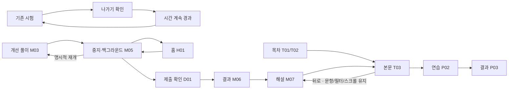

# 전체 화면 UI·UX 처리 및 검증 — 2026-11-11

## 기준과 상태

구현 기준은 0.3.2 소스와 textbook.20261109.2, 목표는 0.3.3(13/19)이다.
조사 당시 Android Play 설치는 0.3.2(18), 한국 App Store 공개 조회는 0.2.0이었다.
이번 조사 화면은 iPhone 시뮬레이터의 별도 0.3.2(12) 테스트 앱이다.
아래 화면 표는 코드 처리 현황이며, 실제 실행 여부는 뒤의 검증 표와 캡처 경로로 구분한다. 원문·채점·해설 공개 규칙·권한·광고 정책은 유지한다.
추가 모의고사 21–60회는 보류한다. 운영 빈도·이탈률 데이터가 없으므로 개선 효과의 수치를 주장하지 않는다.

## 전체 화면 목록

모든 행의 코드를 확인했다. 새 빌드 실화면은 실행 기록에 증거를 연결한 경우만 확인으로 분류한다.
별칭 plan/day→목차, lessonSummary→본문, appearance→설정, calendar→기록,
report/notices→도움말은 중복 집계하지 않는다. 구교재 library/collection/savedQuestion은 현재 앱의 진입 화면이 아니다.
로그인·계정·독립 계산기·실제 SQL 실행 기능은 없다.

| ID | 화면·상태 | 진입 | 목적·주요 행동 | 연결 | 컴포넌트 | 처리 |
|---|---|---|---|---|---|---|
| A01 | 첫 실행 | 최초 설치 | 학습 범위·시작 | A02 | renderTextbook | 공통 적용 |
| A02 | 학습 설정 | A01 | 목표일·화면 설정 | H01 | DateField/renderTextbook | 개선 |
| H01 | 홈 | 홈 탭 | 재개·오늘 분량 확인 | T03/P02/M05 | renderTextbook | 개선 |
| T01 | 목차·검색·저장 필터 | 교재 탭 | 절 찾기·초기화 | T02/T03 | CatalogScrollView | 개선 |
| T02 | 장별 목차 | T01 | 절·학습 목표 선택 | T03/P02 | renderTextbook | 개선 |
| T03 | 교재 본문 | 목차/해설 | 읽기·저장·완료·이동 | T02/P02/T03 | ReadingScrollView/StudyReadables | 개선 |
| T04 | 용어 사전 | 홈/교재 | 검색·설명·관련 절 | T03 | renderTextbook | 공통 적용·기능 유지 |
| T05 | 핵심 카드 | 홈/교재 | 답·알고 있음·이동 | T03 | renderTextbook | 공통 적용·기능 유지 |
| T06 | 출처·범위 | 교재/도움말 | 출처 확인 | 외부/T03 | renderTextbook | 오류 처리 개선 |
| P01 | 연습·복습 선택 | 문제 탭 | 범위·문항 수 선택 | P02 | renderTextbook | 공통 적용 |
| P02 | 문제풀이·해설 | P01/T03 | 선택·확인·다음 | P03/T03 | questionPrompt/answerSummary | 개선 |
| P03 | 연습 결과 | P02 마지막 | 결과·다시 풀기 | P02/T03/H01 | renderTextbook | 공통 적용·집계 유지 |
| M01 | 모의고사 목록 | 실전 탭 | 회차·응시 필터 | M02/M08/M09/M11 | renderMockScreen | 개선 |
| M02 | 응시·광고 안내 | M01 | 모드·시작·광고 선택 | M03/D05 | renderMockScreen | 개선 |
| M03 | 실전/학습 풀이 | M02/M05 | 선택·검토·이동 | M04/M05 | questionPrompt/NativeView | 개선 |
| M04 | 답안표 | M03 | 미응답·검토·제출 | M03/D01 | ResponsiveTiles | 개선 |
| M05 | 일시정지·저장 실패 | 중지/뒤로/앱 전환 | 저장·재개·홈·제출 | M03/H01/D01 | Controller/renderMockScreen | 신규 |
| M06 | 모의고사 결과 | 제출/기록 | 점수·미응답·중지 이력 | M07/M01 | renderMockScreen | 개선 |
| M07 | 회차별 해설 | M06 | 정오 비교·메모·개념 | T03/M06/D02 | answerSummary/CatalogScrollView | 개선 |
| M08 | 오답·미응답 복습 | M01 | 검색·주제·재풀이 | P02/M10 | renderMockScreen | 맥락 보존 개선 |
| M09 | 저장 문항 | M01 | 검색·주제·재풀이 | P02/M10 | renderMockScreen | 맥락 보존 개선 |
| M10 | 저장/복습 해설 | M08/M09 | 해설·저장·메모·개념 | T03 | renderMockScreen | 공통 적용 |
| M11 | 모의고사 기록 | 실전/기록 | 모드별 통계·결과 | M06 | renderMockScreen | 중지 표시 개선 |
| M12 | 모의고사 출처 | M01 | 근거·범위 확인 | 외부 | renderMockScreen | 기능 유지 |
| R01 | 학습 기록 | 기록 탭 | 진도·정답률·최근 결과 | P03/M11/S01 | renderTextbook | 빈 상태 개선 |
| S01 | 설정 | 헤더/기록 | 목표일·화면·저장 | S02–05/호출 화면 | DateField/renderTextbook | 미저장 보호 개선 |
| S02 | 학습 알림 | S01 | 권한·시간·요일 | S01/OS | ReminderSettings | 검토·기능 유지 |
| S03 | 데이터 관리 | S01 | 삭제 범위 확인 | D03 | renderTextbook | 안내 개선 |
| S04 | 개인정보 | S01 | 저장·광고·동의 | D05/외부 | renderTextbook | 정책 유지 |
| S05 | 도움말 | S01 | 중단·해설·기록 안내 | T06/고객지원 | renderTextbook | 문구 갱신 |
| D01 | 최종 제출 확인 | M04/M05/마지막 | 미응답·제출·취소 | M06/호출 화면 | NativeView Modal | 개선 |
| D02 | 해설 문항 선택 | M07 | 문항·닫기 | M07 | ResponsiveTiles/Modal | 공통 적용 |
| D03 | 초기화·전체 삭제 확인 | S03 | 범위 확인·취소 | H01/A01 | Controller/Modal | 정책 유지 |
| D04 | 표 확대·SQL 줄바꿈·날짜 | 교재/문제/설정 | 확대·표시·날짜 선택 | 호출 화면 | StudyReadables/DateField | 공통 적용 |
| D05 | 광고 연령·UMP·보상 SDK | 홈/잠긴 회차/개인정보 | 시청·취소·동의 | M02/호출 화면 | nativeAds/UMP | 정책 유지·재검증 |
| D06 | 미저장 설정 확인 | S01 변경 후 이동 | 수정·변경 취소 | S01/요청 화면 | Controller/Modal | 신규 |
| X01 | 시작 로딩·실패·재시도 | 앱 시작 | 원본 유지·재시도 | A01/H01 | initialize/renderTextbook | 유지 |
| X02 | 빈 상태·검색 없음 | 목차/복습/기록 | 조건 변경·시작 | 해당 목록 | 화면 renderer | 공통 적용 |
| X03 | 저장·외부·광고 실패 | 각 작업 | 안내·재시도 | 호출 화면 | Controller/nativeAds | 개선 |
| X04 | 교재 전환·출시 게이트 | 업그레이드/내부 빌드 | 전환 확인 | H01 | migration/App | 기존 규칙 유지 |

## 문제 근거와 우선순위

| 우선순위·위치 | 실제 관찰 | 사용자 영향 | 개선·검증 |
|---|---|---|---|
| P1 M03–05 | 기존 나가기는 시간이 계속 흐름 | 실제 중단이 어려움 | 저장되는 중지; 시계·복구·저장 실패·앱 전환 검증 |
| P1 M03/P02 | 질문보다 선택지가 굵게 보임 | 질문 우선순위 약함 | 질문 영역·regular 선택지; 같은 문항 비교 |
| P1 M04 | 중간 제출이 답안표 안에 있음 | 종료 행동 발견 어려움 | 중지 화면 제출; 중간·마지막 제출·취소 |
| P1 공통 | 상태 글자 대비 4.25~4.38:1 | 작은 정오 문구 식별 저하 | 상태 글자색 분리·대비 계산 |
| P2 H01 | 학습 제목이 큰 파란 버튼 | 내용과 행동 구분 약함 | 제목·이어하기 분리; 신규/기존 홈 |
| P2 S01 | 탭 이동 시 설정 초안 소실 | 변경 유실 | 변경 시에만 확인; 취소·폐기·저장 |

현재까지 P0 결함을 실제 발견한 것으로 보고하지 않는다.

## 흐름과 변경 영향

공통 NativeView는 모든 버튼·목록·선택지에 영향을 준다. pausedAt이 있는 응시도 active이므로
광고·알림·추가 응시·같은 회차 해설 제한을 유지한다. SQLite 구조와 콘텐츠 버전을 유지하고
새 교재 기록은 지우지 않는다. 과거 제출 점수와 snapshot을 수정하지 않는다.

## 자동 검증

- 코어·네이티브 타입 검사 통과. 전체 431개 테스트 통과.
- 실제 SQLite 트랜잭션 브리지의 일시정지 실패 롤백·재시도 검사 포함.
- Expo doctor 21/21 통과. 콘텐츠 무결성 검사 로그는 별도 보관.
- 이전 화면: evidence/ui-ux-20261111/before-*.png. 상태가 다른 홈은 동일 조건 비교로 주장하지 않는다.

## 새 빌드 실행 기록

테스트 앱만 사용했다. Android 운영 앱 `com.kasa500000.sqldpass`의 데이터는 변경하지 않았다.
iOS 시뮬레이터는 `com.sqldpass.app.adsqa` 0.3.3(13), Android 실기기는 같은 별도 패키지 0.3.3(19)다.

| 시작 상태 / 화면 | 수행한 조작 | 기대 결과 → 실제 결과 | 환경·증거 | 미확인 |
|---|---|---|---|---|
| 신규 설치 A01–02 | 시작·설정 저장·홈 진입 | 실제 교재 범위와 시작 행동 표시 → 통과 | iPhone SE 375pt; `iphone-375/welcome`, `setup`, `home` | Android 신규 설치는 이번에 반복 안 함 |
| 기존 기록 H01 | 설정 저장, 홈·목차·이전 학습 탐색 | 실제 진도·최근 위치 표시 → 통과 | iPhone 402/375pt, iPad1032pt; `home`, `textbook`, `chapter` | 운영 사용성 통계 없음 |
| SQL 교재 T03 | c1-s5 읽기·SQL 줄바꿈·아래 이동·읽음 완료 | 한국어·코드가 읽기 폭 안에 표시되고 완료 저장 → 통과 | 세 시뮬레이터 `lesson-sql`, `lesson-lower`; iPad1376pt `landscape-lesson` | 216절 전체를 수동으로 읽지는 않음 |
| 연습 P01–03 | 5문항 선택·확인·해설·다음·결과 | 제출 전/후 구분, 마지막 결과 도달 → 통과 | 세 시뮬레이터 `practice-selected`, `practice-feedback`, `practice-result` | 전 문항 수동 검증 아님 |
| 실전 M03–04 | 1번 정답·2번 오답·검토 표시·미응답 필터·50번 이동 | 미응답에서 답한 1번 제외, 선택 보존 → 통과 | 세 시뮬레이터 `answer-sheet-unanswered`, `exam-last` | 90분 실시간 대기는 미실시; 만료는 자동 검사 |
| 풀이 M05 | 중지·앱 종료·재시작·이어하기·OS 홈·복귀 | 중지 시계 고정, 답안 보존, 자동 중지 후 명시적 재개 → 통과 | 세 시뮬레이터 및 Samsung360dp `restored-pause`, `background-pause` | OS 프로세스 사망 직전 보상 복구 보장 없음 |
| 제출 D01/M06 | 제출 취소 후 다시 제출 | 취소는 중지 유지; 정답1/오답1/미응답48, 2점 → 통과 | 세 시뮬레이터와 Samsung `submit-confirm`, `exam-result`/`result` | 없음 |
| 해설 M07 | 오답·미응답·관련 교재·뒤로·50번 선택·메모·저장 | 내 답/정답 비교, 원래 해설 복귀, 키보드 상태 저장 → 통과 | 세 시뮬레이터 `review-wrong`, `review-related-textbook`, `review-last`, `review-note-keyboard` | 메모 한국어 IME 장문은 별도 미실시 |
| 복습·저장·기록 M08–11/R01 | 각 목록·필터·결과 진입 | 제출 기록과 분리된 학습 목록 → 통과 | iPhone402 `mock-review-list`, `mock-saved-list`; 공통 `exam-history`, `records` | 재풀이 후 원점수 보존은 자동 회귀 검사 |
| 검색·카드 T01/T04/T05 | 없는 검색어·초기화·북마크 필터·NULL 검색·카드 뒤집기·앞뒤·미학습 필터 | 빈 상태 복구 및 의미 있는 필터 → 통과 | iPhone402 `search-empty`, `bookmarks-filter`, `glossary-search`, `flashcard-answer` | 스크린리더 발화 순서 미검증 |
| 설정·알림·삭제 S01–03/D03/D06 | 변경 후 탭 이동·취소·저장, 알림 화면, 초기화·전체 삭제 취소 | 미저장 변경 보호, 취소 후 기록 유지 → 통과 | 세 시뮬레이터 `unsaved-settings`; iPhone402 `reminders`, `reset-confirm`, `delete-confirm` | 알림 실제 도착은 이번에 미검증 |
| 다크·앱 글자130% | 설정 저장 후 홈·학습모드·중지 | 대비·줄바꿈·주요 행동 접근 → 통과 | 세 시뮬레이터 `home-dark-large`, `study-dark-large`, `paused-dark-large` | Android 시스템 최대 글자 미실시 |
| iOS 최대 시스템 글자 | 접근성 최대 크기에서 시작·답 선택·중지·제출·결과 | 스크롤을 통해 전 과정 완료 → 통과 | iPhone402 `system-largest-*`; `logs/native-large.log` | 긴 문항은 스크롤 증가, 가독성 사용자 연구 없음 |
| iPad 가로 | 본문·시험·중지·제출 | 읽기 폭720 유지·조작 가능 → 통과 | 1376pt `landscape-*`, `logs/native-landscape.log` | 폴더블 접힘 전환·태블릿 실기기 미검증 |
| 광고 D05 | 홈 연령 확인 취소·확인, 테스트 배너, M11 보상 완료, 학습 시작·중지 후 홈 | 취소 무광고/동의 후 테스트 배너, earned 이후 해제, 중지 중 배너 없음 → 통과 | Samsung `ad-declined-home`, `test-banner`, `reward-current`, `reward-earned11`, `adult-active-study-home` | M19/20는 닫기 전에 보상이 발생했으므로 조기 취소 통과로 기록하지 않음 |
| 개인정보·도움말 S04–05 | 안내·FAQ 펼침 | 현 정책·중단 안내 표시 → 통과 | 세 시뮬레이터 `privacy`, `help` | 외부 사이트 장애는 주입 테스트로만 확인 |
| 0.3.2→0.3.3 업데이트 | 설치 전 SQLite와 설치 후 비교 | 설정·응답·진도·권한·시험·immutable snapshot 동일 → 통과 | iOS 별도 테스트 앱 `upgrade-preservation.json`, 시험1개/응답5개 | 운영 앱 삭제·재설치 복원은 지원 안 함 |
| 저장 실패 X03 | 실제 NativeRepository SQLite 브리지에서 트랜잭션 실패·재시도 | 롤백, 중지 보호, 재시도 성공 → 통과 | 자동 테스트 `tests/sqlite-repository.test.cjs` 및 pause tests | 네이티브 화면에서 디스크 가득 참을 만들지는 않음 |

모든 캡처는 [증거 폴더](evidence/ui-ux-20261111/)의 해당 디렉터리이며, 주요 전후 화면은
[실제 화면 갤러리](evidence/ui-ux-20261111/gallery.html)에서 비교한다. 원본 크기를 보존했다.
`logs/native-iphone4.log`, `native-se3.log`, `native-ipad2.log`, `native-aux2.log`,
`native-large.log`, `native-landscape.log`는 각각 최종 성공 실행이다.
테스트 도중 스크롤 영역/중복 이름 locator를 수정했고, 해당 초기 하네스 실패는 앱 결함이나 통과 증거로 세지 않았다.

### 확인 수준별 화면 처리

- **실화면 확인·개선:** H01, T01–03, P01–03, M01–07, M11, R01, S01/S03/S05, D01/D02/D06, X02.
- **실화면 확인·기능 유지:** A01–02, T04/T05, M08/M09 목록, S02/S04, D03. T03의 표/SQL은 대표 자료만 확인.
- **일부 확인:** D04의 SQL 줄바꿈·표시는 확인, 날짜/표 확대 모든 상태는 미확인. D05는 Android 현재 테스트 광고 및 기본 지역 UMP만 재검증; EEA 허용·거부·철회는 11월9일 동일 SDK/정책 증거이며 신규 실행과 구분.
- **코드·자동 검사만 확인:** T06/M12 출처의 모든 외부 링크, M10 독립 복습 해설의 전체 분기, X01 시작 실패, X03 네트워크/저장 실패 전체 네이티브 화면, X04 전환 notice. 각 화면은 공통 스타일을 적용하되 미확인 항목을 통과로 표시하지 않는다.
- **남은 기기 검증:** iPad 실기기 새 빌드는 설치 준비 완료, 연결 불가 상태로 현재 검증 대기. VoiceOver/TalkBack 실제 발화 검사는 미실시.

### 접근성 기준과 측정

[Apple 접근성 가이드](https://developer.apple.com/design/human-interface-guidelines/accessibility)와
[Android 접근성 가이드](https://developer.android.com/guide/topics/ui/accessibility/apps)를 기준으로
주요 네이티브 터치 영역 최소48 layout units를 유지했다(iOS pt, Android dp).
[WCAG 일반 글자 대비](https://www.w3.org/WAI/WCAG22/Understanding/contrast-minimum.html)와
[글자 확대](https://www.w3.org/WAI/WCAG22/Understanding/resize-text.html)를 참고했다.
`contrast.json`의 16개 본문/보조/상태 글자·배경 조합은 모두4.5:1 이상이다.
이는 측정한 조합만의 결과이며 모든 픽셀·초점·스크린리더를 포함한 WCAG 인증은 아니다.
색상 외 선택 문구, 내 답/정답, 정오 아이콘과 접근성 상태를 유지했다. 모달 전환 애니메이션을 제거했다.

### 실행 및 변경 파일

- 시작: `npm ci`, `npm start`; 네이티브 `npm run android`/`npm run ios`. 테스트 광고는 별도 internal bundle와 공식 test ID로만 실행.
- 상태: `src/core/domain/exam.ts`, `src/core/controller.ts`, `App.tsx`.
- 공통: `src/ui/nodes.ts`, `src/platform/NativeView.tsx`, `StudyReadables.tsx`, `ReadingScrollView.tsx`, `CatalogScrollView.tsx`.
- 화면: `src/textbook/views.ts`, `src/mocks/views.ts`, `src/ui/learning-content.ts`.
- 자동 검사: `npm test`, `npm run typecheck`, `npm run typecheck:native`, `npm run content:check`, `npx expo-doctor`.
- 네이티브 UI runner: [UXCaptureTests.swift](runners/UXCaptureTests.swift). 별도 XCTest UI target에서 공식 테스트 앱을 대상으로 실행. 출시 앱을 테스트 대상으로 사용하지 않는다.

화면별 PR40–47은 독립 커밋으로 검토 가능하며 각 브랜치 GitHub Actions와 통합 QA 후 main에 merge했다.
검증 요약은 정상 동작 주장과 미검증 범위를 함께 읽어야 한다.

## 출시 상태

새 버전 미제출. 운영 광고 승인 증거·서명 산출물·스토어 수신 상태 확인 후 갱신한다.

## 학습 도구 목록

37개 전체 원문 상태·전환 자동 검사는 통과했다. 새 빌드 실화면 확인 여부는 개별 증거가 있을 때만 갱신한다.

| 도구 ID | 제목 | 컴포넌트 | 새 빌드 실화면 |
|---|---|---|---|
| table-anatomy | 직접 확인 · 표의 네 층위 | TextbookWidget | 본문 표시 확인 (`iphone-402/lesson-widget`), 모든 조작 미확인 |
| model-stages | 직접 확인 · 설계 단계 | TextbookWidget | 미확인 |
| cardinality | 직접 확인 · 관계선 읽기 | TextbookWidget | 미확인 |
| identifying | 직접 확인 · PK 포함 여부 | TextbookWidget | 미확인 |
| normalization | 직접 확인 · 정규화 단계 | TextbookWidget | 미확인 |
| join | 직접 확인 · 조인 결과 | TextbookWidget | 미확인 |
| transaction | 직접 확인 · 확정과 취소 | TextbookWidget | 미확인 |
| null-aggregate | 직접 확인 · NULL과 집계 | TextbookWidget | 미확인 |
| projection | 직접 확인 · DISTINCT의 기준 | TextbookWidget | 미확인 |
| truth | 직접 확인 · TRUE / FALSE / UNKNOWN | TextbookWidget | 미확인 |
| string-slice | 직접 확인 · SUBSTR 위치와 길이 | TextbookWidget | 미확인 |
| null-functions | 직접 확인 · NULL 함수 비교 | TextbookWidget | 미확인 |
| aggregate-null | 직접 확인 · NULL과 집계 분모 | TextbookWidget | 미확인 |
| group-pipeline | 직접 확인 · WHERE → GROUP → HAVING | TextbookWidget | 미확인 |
| sort-nulls | 직접 확인 · DBMS별 NULL 정렬 | TextbookWidget | 미확인 |
| join-matrix | 직접 확인 · 연결쌍과 결과 행 수 | TextbookWidget | 미확인 |
| join-filter | 직접 확인 · ON과 WHERE | TextbookWidget | 미확인 |
| subquery-quantifier | 직접 확인 · ANY·ALL과 빈 집합 | TextbookWidget | 미확인 |
| anti-null | 직접 확인 · 미주문 고객과 NULL | TextbookWidget | 미확인 |
| set-operation | 직접 확인 · 집합 연산과 행 수 | TextbookWidget | 미확인 |
| grouping-sets | 직접 확인 · 그룹 조합과 소계 | TextbookWidget | 미확인 |
| ranking | 직접 확인 · 동점 순위·분포·버킷 | TextbookWidget | 미확인 |
| window-frame | 직접 확인 · ROWS·RANGE의 실제 범위 | TextbookWidget | 미확인 |
| lag-lead | 직접 확인 · 행 없음과 NULL 값 | TextbookWidget | 미확인 |
| topn | 직접 확인 · 상위 N행과 동점 | TextbookWidget | 미확인 |
| hierarchy | 직접 확인 · 방향·시작점·필터 | TextbookWidget | 미확인 |
| pivot-shape | 직접 확인 · 입력 열과 피벗 결과 | TextbookWidget | 미확인 |
| regex-check | 직접 확인 · 정규식과 반환 종류 | TextbookWidget | 미확인 |
| insert-default | 직접 확인 · 생략·기본값·NULL | TextbookWidget | 미확인 |
| dml-target | 직접 확인 · 대상 행과 변경 결과 | TextbookWidget | 미확인 |
| merge-branches | 직접 확인 · MERGE의 분기 | TextbookWidget | 미확인 |
| constraint-check | 직접 확인 · CHECK와 NOT NULL | TextbookWidget | 미확인 |
| fk-actions | 직접 확인 · 부모 삭제와 자식 행 | TextbookWidget | 미확인 |
| ddl-compare | 직접 확인 · 비우기·제거·취소 | TextbookWidget | 미확인 |
| tx-timeline | 직접 확인 · 현재값·확정값·저장점 | TextbookWidget | 미확인 |
| ddl-boundary | 직접 확인 · 실패한 명령과 확정 경계 | TextbookWidget | 미확인 |
| grant-chain | 직접 확인 · 권한 재부여와 회수 경로 | TextbookWidget | 미확인 |
